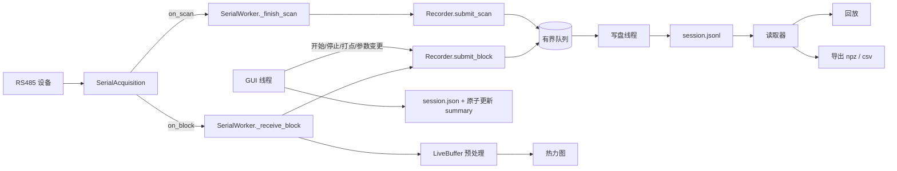

# 数据采集与保存方案（录制 / 回放 / 导出）

面向本仓库现有代码（`src/skin_draw`）的落地设计，衔接 `docs/软件设计方案.md` 第 9 节，
把"建议用带版本号的 JSONL"细化为可实施的格式、线程模型、接入点和验收标准。

状态：方案，**未实现**。日期：2026-10-19。

---

## 0. 结论摘要

| 决策 | 选择 | 关键理由 |
|---|---|---|
| 采集落点 | `SerialWorker._receive_block` / `_finish_scan` | 每个被解析器接受的数据块必经此处；GUI 侧 `LiveBuffer.take()` 会主动合并快照，**不能**作为录制源 |
| 记录粒度 | 逐 **Block** 一行 + `scan` 行作为分帧边界 | Block 是解析器输出的原子单位；崩溃只影响尾部；连续/轮询两种模式语义一致 |
| 写入格式 | 会话目录 = `session.json`（元数据）+ `session.jsonl`（追加日志） | 追加安全、逐行可恢复、标准库可读写、可 `grep`；进程被强杀最多丢尾部几秒 |
| 分析格式 | 停止时物化 `session.h5`（HDF5：类型化多维数据集、可切片、可压缩） | Python/MATLAB 直读；与写入路径解耦，见 §4.7 |
| CSV | 只做宽表导出与跨会话索引 | CSV 是"一张表"，装不下嵌套元数据与变长块列表，见 §4.6 |
| 存什么 | **只存原始 ADC 及其到达时间**；预处理参数、基线快照、孔位掩码、打点作为事件/元数据 | 原始值是唯一真值，派生值随代码版本变化 |
| 写入方式 | 独立写盘线程 + 有界队列；串口线程只做 O(1) 入队 | 沿用 `diagnostics.py` 的"日志不阻塞采集"原则，但**不允许静默丢数据** |
| 默认目录 | `<项目根>/recordings/`，冻结后 `<exe目录>/recordings/`，回退 `%LOCALAPPDATA%\SkinDraw\recordings` | 与 `diagnostics.setup_logging`、`sensor_masks.default_mask_path` 的路径策略一致 |
| 依赖 | 录制仅标准库；HDF5 物化为**可选**依赖 `h5py` | 采集路径不因新依赖变脆；没装 h5py 也能录、能回放、能导 npz/csv |
| 实施 | M1 录制 → M2 回放 → M3 导出/打点 → M4 长稳 | 每期独立可验收，见 §14 |

一个贯穿全文的前提：**串口 115200-8N1 的物理上限是 11520 字节/秒**。
因此录制链路的吞吐不是瓶颈，格式选择应当为"可读、可恢复、元数据完整"服务，
而不是为压缩率服务。

---

## 1. 现状：数据在哪产生、在哪会丢

| 位置 | 事实 | 对录制的含义 |
|---|---|---|
| `acquisition.py:112`、`:195` | 轮询/连续模式都调用 `on_block(block)`，随后才等总线安静或等下一轮 | 这是**已接受块的唯一出口**，也是录制的天然落点 |
| `acquisition.py:165`、`:177` | 每轮结束调用 `on_scan(Scan(...))`，带 `expected_ids` / `elapsed` / `protocol_errors` | 提供分帧边界与缺块信息，但**块本身不带轮次号** |
| `ui/serial_worker.py:43-49` | `_receive_block` / `_finish_scan` 把两者转给 `LiveBuffer` 并发信号 | 只需在这两处各加几行，不必改采集逻辑 |
| `live.py:97-125` | `receive()` 在锁内做预处理（M3 + 慢基线，纯 Python 逐点循环） | 录制必须在它之前/之外入队，避免与锁竞争 |
| `live.py:234-239` | `take()` 在 `not dirty` 时返回 `None`；只保留"最新状态" | **GUI 拿到的快照有丢失**，绝不能用于录制 |
| `main_window.py:665-673` | 4 ms 合并刷新 + 批量绘制 | 同上 |
| `models.py:13-43` | `Block` 冻结、`values` 只读 C 序 `uint16`；`Frame` 校验 ID 不重复 | 可零拷贝跨线程传递，无需防御性复制 |
| `models.py:36-40` | `Block` **没有时间戳**；时间只在 `LiveBuffer.received_at` / `reception_rate` | 录制器必须自己在到达时刻打点 |
| `preprocessing.py:145-147` | `upd_n = round(fps × upd_sec)`，`fps` 是实测的每块速率 | 离线复算需要每块到达时间，否则基线跟踪节奏对不上 |
| `preprocessing.py:170` | 前 `w`(30) 帧不喂基线 | 离线复算需从会话第一块开始，不能从中段切片 |
| `sensor_masks.py:66-83` | 掩码单独存 `configs/sensor_masks.json`，改掩码会触发重标定 | 录制必须快照掩码，否则离线复算的 NaN 位置不同 |
| `diagnostics.py:45-81` | 有界日志队列 + 丢弃计数；`temp → fsync → os.replace` 的原子写 | 直接复用这两套成熟做法 |

结论：**录制是采集侧的旁路，不是显示侧的旁路。**

---

## 2. 目标与非目标

**目标**

1. 一次实验的数据可完整落盘，进程崩溃/断电最多损失尾部若干秒，且文件仍可解析。
2. 文件自解释：换一台电脑、隔一个月，仍能说清"这是什么、怎么来的、缺了什么"。
3. 录制不影响采集与界面：GUI 刷新率、串口超时统计与不录制时基本一致。
4. 可复算：用原始 ADC + 记录的参数，能离线再现当日显示的热力图。
5. 可导出：Python / MATLAB / Excel 都能直接吃到数据。
6. 录制路径不引入新依赖（HDF5 物化是可选附加）。

**非目标（首版）**

- 不做数据库、不做多用户、不做网络同步。
- 不存渲染图像序列、不存颜色映射结果。
- 不做"边录边算"的在线分析。
- 不承诺跨版本格式兼容，只承诺**版本号 + 读取器给出明确报错**。

---

## 3. 数据流



关键顺序：**先入队、再预处理、最后绘图**。录制不依赖 `LiveBuffer` 的任何状态。

---

## 4. 文件格式

### 4.1 目录结构

```text
recordings/
└─ 20261019-152031_COM5/
   ├─ session.json        元数据 + 结束时写入的 summary（原子替换）
   ├─ session.jsonl       录制日志：block / scan / event / baseline
   └─ session.h5          停止后物化，分析用（可从 .jsonl 完整重建）
```

三个文件对应三种读者：人、崩溃恢复、分析软件（§4.6）。
归档时通常只留 `.h5`；`.jsonl` 是审计与重建的依据，建议保留到论文数据定稿。

- 目录名：`<YYYYMMDD-HHMMSS>_<端口>`，端口中的非字母数字替换为 `-`；
  同名已存在时追加 `-2`、`-3`。**不使用中文和空格**，避免 `fsync`/长路径问题。
- 若单文件超过 512 MB，滚动为 `session.part2.jsonl`，读取器按文件名排序拼接。
  （按 §11 的估算，普通实验 12 小时才到这个量级，属于兜底。）

### 4.2 `session.json`

开始录制时写一次；结束时读回、合并 `summary`、用 `temp + fsync + os.replace` 覆盖。
示例：

```json
{
  "format": "skindraw-session/1",
  "session_id": "20261019-152031_COM5",
  "created_at": "2026-10-19T15:20:31.483+08:00",
  "ended_at": "2026-10-19T15:51:07.902+08:00",
  "software": {"name": "SkinDraw", "version": "0.1.0", "python": "3.11.9",
               "platform": "Windows-10-10.0.22631-SP0"},
  "clock": {"monotonic": "perf_counter", "t0_wall": "2026-10-19T15:20:31.480+08:00",
            "note": "行的 t 字段 = 进程内 perf_counter 相对本会话起点的秒数，跨进程不可比"},
  "source": {"kind": "serial", "port": "COM5", "device": "USB-SERIAL CH340 (COM5)",
             "baudrate": 115200, "format": "8N1", "mode": "poll", "protocol": "text",
             "response_timeout": 0.8},
  "display_mode": "preprocessed",
  "processing": {"norm": "B", "direction": "drop", "calib_n": 270, "r_ref": 600,
                 "window": 30, "delta": 150, "n_min": 3, "alpha": 0.2},
  "blocks": [{"id": 1, "rows": 5, "cols": 4}],
  "sensor_masks": {"1": [[1,1,1,1],[1,1,1,1],[1,1,1,1],[1,1,1,1],[1,1,1,1]]},
  "layout": [{"block_id": 1, "rows": 5, "cols": 4, "rotation": 0,
              "flip_x": false, "flip_y": false}],
  "operator": "ywj", "note": "",
  "summary": {
    "records": 50123, "blocks": 49890, "scans": 1247, "dropped": 0,
    "bytes": 8421993, "duration_s": 1836.419,
    "end_reason": "user_stop", "truncated": false
  }
}
```

字段说明（只列容易踩坑的）：

- `display_mode`：`raw_adc` 或 `preprocessed`。决定回放/复算时是否启用基线链。
- `processing`：`calib_n`、`r_ref`、`alpha` 等真实常量在 `live.py` / `preprocessing.py` 里，
  录制时从运行中的对象读取，**不要**在文档里硬编码默认值，否则改代码后对不上。
- `sensor_masks`：直接转成 0/1 整数，避免 `true/false` 与读取端布尔约定不一致。
- `clock.note`：一句话解释 `t` 的语义，比任何 schema 文档都可靠。
- `summary.end_reason`：`user_stop` / `disconnect` / `window_close` / `overflow` /
  `disk_error` / `exception`。分析时必须能区分"我按了停止"和"程序崩了"。

### 4.3 `session.jsonl`

每行一个独立 JSON 对象，UTF-8，`\n` 结尾，**文件顺序即时间顺序**。

**block（核心，每个被接受的块一行）**

```json
{"v":1,"kind":"block","n":1234,"t":57.412031,"wall":"2026-10-19T15:21:28.895+08:00",
 "id":3,"shape":[5,4],
 "adc":[2011,2008,2005,2001,1998,1995,1990,1988,1985,1980,1978,1975,1972,1970,1968,1965,1962,1960,1958,1955]}
```

- `adc` 为**扁平、行优先**的 uint16，长度必须等于 `rows × cols`；
  形状单列 `shape`，既省字节又让读取端能校验。
- 坐标是**硬件原始行列**，在任何旋转/翻转/掩码之前。
- `id` 用 `1..16`，与 `Block` 校验一致。
- `t` 保留 6 位小数（微秒级），`wall` 带时区偏移、毫秒精度。
- `n` 是录制器自己的单调计数器，用于崩溃后核对行数是否连续（可选但便宜）。

**scan（分帧边界 + 缺块）**

```json
{"v":1,"kind":"scan","n":1235,"t":57.903114,"seq":42,
 "expected":[1,2,3,4],"received":[1,3,4],"missing":[2],"elapsed":0.291,"errors":0}
```

- 一帧 = 本条 `scan` 之前、上一条 `scan` 之后的全部 `block` 行。
  这样块不需要提前知道轮次号（`SerialAcquisition` 的 `sequence` 在轮末才自增），
  崩溃时也不会丢掉"已收到但尚未收完一轮"的块。
- `errors` 是 `parser.errors` 的累计值，重复但便于直接定位坏帧区间。
- `missing` 可由 `expected − received` 推出，仍显式写出，方便人肉阅读。

**event（状态与人为标记）**

```json
{"v":1,"kind":"event","n":1236,"t":58.100,"wall":"...","name":"marker","note":"加载 200 g 砝码"}
{"v":1,"kind":"event","t":60.2,"name":"norm","value":"A"}
{"v":1,"kind":"event","t":61.0,"name":"direction","value":"rise"}
{"v":1,"kind":"event","t":75.4,"name":"shape_change","id":3,"shape":[5,5]}
{"v":1,"kind":"event","t":80.0,"name":"recalibrate"}
{"v":1,"kind":"event","t":81.2,"name":"mask_change","id":3,"valid":21}
```

固定事件名：`start`、`stop`、`marker`、`norm`、`direction`、`recalibrate`、
`shape_change`、`mask_change`、`overflow`、`disk_error`、`note`。

**baseline（基线快照）**

```json
{"v":1,"kind":"baseline","t":3.402,"id":1,"shape":[5,4],
 "base":[[2011.5,2008.0,null,2001.0,...]]}
```

- 只在 `preprocess.ready` 时写；开始、结束、以及用户"重新标定"后各写一次。
- **NaN 必须写成 `null`**，读取端再转回 `NaN`——JSON 没有 NaN，
  直接 `json.dumps(np.nan)` 会产出非法字面量 `NaN`，`json.loads` 虽能读，
  但 pandas / MATLAB / jq 都会报错。这是本格式最容易翻车的一处。

### 4.4 编码约定

| 项 | 约定 |
|---|---|
| 数组顺序 | 行优先（row-major），`shape` 为 `[rows, cols]` |
| 数值类型 | ADC 为 `0..4095` 整数；基线为浮点或 `null` |
| 缺失点 | 基线用 `null`；没有数据的块直接不出现，由 `scan.missing` 表达 |
| 布尔 | 掩码用 `0/1` 整数 |
| 版本 | 每行 `v`，与 `session.json.format` 双重声明 |
| 扩展 | 读取器忽略未知 `kind` 和未知字段，只在 summary 里计数 |

### 4.5 为什么录制格式不是 CSV / SQLite / 直接写 HDF5

| 方案 | 优点 | 为什么不选 |
|---|---|---|
| 无表头 `frames.csv` | Excel/MATLAB 直接可读 | 每帧块数可变、缺块无位置表达、元数据无处安放、写到一半无法定位 |
| 每帧一个 `.npy` | 读取快 | 一次实验数万个小文件；元数据分散；不完整帧难以识别 |
| SQLite | 可查询、事务 | schema 演进与数组 BLOB 让"打开就能看懂"这件事消失；对单人科研工具偏重 |
| 自定义二进制容器 | 紧凑 | 要自写读写器与版本兼容；崩溃恢复更复杂；出问题时无法直接看 |
| 直接写 HDF5 | 类型化数组、压缩、切片、MATLAB 直读 | 强杀后可能整文件打不开；追加要 chunked+resize；HDF5 默认文件锁让"录制中拿 MATLAB 预览"变麻烦；把分析格式绑死在写入路径上。详见 §4.7 |
| **JSONL 日志 + HDF5 物化** | 写入服从可靠性，读取服从工具链 | 多一个物化步骤与一份临时副本（每小时几十 MB，可接受） |

若将来真要按条件检索上千个会话，再引入 DuckDB（可直接
`read_json_auto('session.jsonl')`）做**外部**分析，不必进主程序依赖。

### 4.6 三种载体，三种读者

| 文件 | 存在时间 | 读者 | 为什么是它 |
|---|---|---|---|
| `session.jsonl` | 录制中，逐行追加 | 崩溃恢复、排查、回放 | 一行损坏不影响前文；`grep`/编辑器可看；标准库可写 |
| `session.h5` | 停止后物化，可随时重建 | 分析（Python / MATLAB） | 类型化多维数组、按块切片、压缩、单文件自描述 |
| `*.csv` | 按需导出 | Excel、快速核对 | 表格软件零门槛 |

原则：**写的时候服从可靠性，读的时候服从工具链，两者不必是同一个文件。**

#### 为什么元数据不能用 CSV

CSV 只提供"一张二维表"这一个结构，而会话元数据是一棵树：

- `blocks` 是变长列表（1–16 项，每项含 id / rows / cols / 形状历史）；
- `sensor_masks` 是每块一张 16×16 布尔矩阵；
- `source`、`processing` 是嵌套字典，字段随功能增加；
- `summary` 只在结束时出现，且 `end_reason` 是枚举。

塞进 CSV 只有两条路：拆成 `session.csv` + `blocks.csv` + `masks.csv` +
`processing.csv` 四个文件（仍会丢类型和"字段不存在"的语义），
或者退化成 `key,value` 两列（矩阵变成 `"1;0;1;0;…"`，没人愿意手工核对）。
另外 Excel 会悄悄把 `COM5` 当地址、把 `00123` 的前导零吃掉。

CSV 在本方案里的正确位置只有两个：**按块宽表导出**（§10.3）和
**跨会话索引**（`sessions.csv`，一行一个会话，便于排序筛选）。

#### 为什么元数据不直接写成 HDF5 属性

可以，但 HDF5 属性是"扁平、有大小限制的键值袋"：嵌套要展开成 group，
变长列表要变成 compound dataset，可选字段只能靠"属性不存在"表达，
掩码/基线这类矩阵只能另建 dataset。分析端于是要写一段专门的 HDF5 遍历代码，
才能回答"这次实验用的什么滤波参数"。

所以元数据在**写路径**上是 JSON 文档（嵌套、可选、可 diff、随代码演进），
物化时再映射成 HDF5 的**原生属性与数据集**（§4.7）。
也就是说：**做分析时你面对的是 .h5 里的 attrs 和 dataset，不是 JSON 字符串。**
`session.json` 只是它在录制期的可读副本。

> 同行做法可参照 BIDS（影像元数据用 JSON 侧车文件）与 OME-Zarr（JSON 元数据 +
> 二进制分块）：元数据与数值数组本来就是两种东西，分开存是常态，不是妥协。

#### JSON 的短板，以及为什么它只配待在写路径

| 短板 | 后果 | 规避 |
|---|---|---|
| 没有 `NaN`/`Inf` 字面量 | 基线空点会写出非法行 | 空点写 `null`，读回转 `NaN`（§4.3） |
| 数字是文本 | 体积 2–3 倍、无 dtype、浮点精度靠约定 | 只放元数据与日志，不做分析主格式 |
| 无 schema | 字段漂移难发现 | 每行带 `v`，读取器做白名单校验 |
| 不可随机访问 | 查第 3 块第 1000 帧要扫全文 | 物化成 HDF5 后按 dataset 切片 |

### 4.7 HDF5 物化结构（`session.h5`）

由 `session.jsonl` **单向**生成，任何时候都能重建，不参与录制写入。

```text
session.h5
├─ /                          attrs: format, session_id, created_at, ended_at,
│                                    software, duration_s, end_reason
├─ /meta/source               attrs: kind, port, device, baudrate, format, mode,
│                                    protocol, response_timeout
├─ /meta/processing           attrs: display_mode, norm, direction, calib_n, r_ref,
│                                    window, delta, n_min, alpha
├─ /meta/clock                attrs: monotonic, t0_wall
├─ /meta/blocks               dataset (id u1, rows u1, cols u1, first_t f8, last_t f8, count i4)
├─ /meta/layout               dataset (block_id u1, rows u1, cols u1, rotation u2,
│                                       flip_x u1, flip_y u1)
├─ /meta/masks/b01 … b16      dataset uint8 (rows, cols)         # 1=有效；缺省表示全有效
├─ /frames/t                  float64 (n,)
├─ /frames/expected_mask      uint16  (n,)      # bit(i-1)=第 i 块本轮应有
├─ /frames/received_mask      uint16  (n,)      # 缺块直接由位与得到
├─ /frames/elapsed            float32 (n,)
├─ /frames/errors             int32   (n,)      # 累计协议错误（重复但便于定位）
├─ /data/b01/adc              uint16  (n, rows, cols)  chunk=(256, rows, cols)  gzip 1
├─ /data/b01/t                float64 (n,)
├─ /data/b01/frame            int32   (n,)
├─ /data/b03_v2/…             形状变化后的第二段（键名带版本后缀）
├─ /events/t, wall, name, note
└─ /baseline/b01/t            float64 (k,)
   /baseline/b01/value        float32 (k, rows, cols)          # NaN = 空点
```

读取：

```python
import h5py
with h5py.File("session.h5", "r") as f:
    adc = f["/data/b01/adc"][:]                  # (n, 5, 4) uint16
    t = f["/data/b01/t"][:]                      # (n,)
    norm = f["/meta/processing"].attrs["norm"]   # 'none' / 'A' / 'B'
```

```matlab
adc = h5read('session.h5', '/data/b01/adc');
t   = h5read('session.h5', '/data/b01/t');
```

> **不要把 `.h5` 改名成 `.mat` 再 `load`**：`.mat -v7.3` 虽然是 HDF5 容器，
> 但要求 MATLAB 专有的组结构（`#refs#` 等）。通用 HDF5 请用 `h5read`。

为什么**录制**不直接写 HDF5：

| 维度 | JSONL 日志 | 直接写 HDF5 |
|---|---|---|
| 进程被强杀 / 断电 | 最后一行可能半截，前面全部可读 | 元数据可能损坏，最坏整文件打不开；常常要清理写标志或修复 |
| 追加写入 | `write()` 即可 | chunked + `maxshape=(None,…)`，每批 `resize`，写放大的调优 |
| 边录边看 | `tail -f`、编辑器、`grep` | 需专门工具；HDF5 默认文件锁还会挡住 MATLAB 并发读 |
| 形状中途变化 | 每行自带 `shape` | 需切换到新 group（`b03_v2`） |
| 依赖 | 标准库 | `h5py` + HDF5 运行库，打包多一项 |
| 分析读取 | 解析全文 | 直接切片；同数据体积约 1/3–1/4 |

一句话：**用日志承受故障，用 HDF5 承受分析。**
停止录制时若 `h5py` 可用就自动物化；不可用只提示，不影响已录数据与回放。

---

## 5. 存什么、不存什么

### 5.1 只把原始 ADC 当真值

- 存：`Block.values`（原始 ADC）+ 到达时间 + 形状。
- 不存：`display_values`（M3 滤波/归一化结果）、色阶、渲染像素。
- 原因：`BlockPreprocessor` 是**有状态且依赖启动时刻**的——前 30 帧不喂基线、
  基线按实测 fps 每 ~1 秒更新一次、掩码变化会重建。把派生值当数据存，
  等于把实现细节写进数据；改一行滤波代码，历史数据就不可比。
- 代价：想 100% 还原"当时屏幕上那一帧"，需要同一份代码 + 同样的到达时间序列。
  通常不需要；若确实需要逐像素对齐，开诊断开关额外写 `kind:"display"`（默认关）。

### 5.2 时间是双轨的

| 字段 | 来源 | 用途 | 注意 |
|---|---|---|---|
| `t` | `perf_counter() − t0` | 计算间隔、帧率、基线跟踪节奏、回放调度 | 跨进程无意义，**不能**持久化成绝对值 |
| `wall` | `datetime.now().astimezone()` | 与外部刺激日志/摄像机/试验机对齐 | NTP 校准可能造成跳变；跳变时以 `t` 为准 |

不存裸的 `perf_counter` 值：它在 Windows 上是进程内相对量，重开程序就毫无意义。
`session.json.clock` 里只保留"起点墙钟 + 单调时钟名"作为说明。

### 5.3 必须随会话快照的配置

1. **孔位掩码**：决定哪些点输出 NaN，直接改变矩阵语义。
2. **预处理参数**：`norm`、`direction`、`calib_n`、`r_ref`、`window`、`delta`、`n_min`、`alpha`。
3. **连接参数**：端口、波特率、`mode`、`protocol`、`response_timeout`。
4. **布局/朝向**（可选）：只影响显示，但出图复现时需要。
5. **采样方式**：`poll` / `stream`——两者帧边界语义不同，分析时必须知道。

### 5.4 用户打点（强烈建议）

实验数据如果没有刺激时刻，后期只能靠猜。一个"打点"按钮（快捷键 `M`）
写一行 `event/marker`，成本极低，价值极高：砝码加载/卸载、吹气、弯折、
视频开始录制、换受试者，都应在数据流里留一个位置。

---

## 6. 写入实现

### 6.1 线程与职责

```text
GUI 线程        创建/关闭 Recorder，读状态、写元数据、更新界面
串口线程        submit_block / submit_scan —— 只做时间戳 + 入队，不碰磁盘
写盘线程        序列化、批量写、flush、fsync、错误上报
```

规则：

1. `submit_*` **永不抛异常、永不阻塞超过 250 ms**、**永不打开文件**。
2. 文件句柄只属于写盘线程；`close()` 通过哨兵对象交接，`join(10)` 后由 GUI 收尾。
3. `Block` 冻结且数组只读，可零拷贝入队；不要调 `tolist()` 或复制矩阵。
4. GUI 只读 `records` / `bytes` / `error` / `dropped` / `path` 这几个标量。

### 6.2 接口草案（`src/skin_draw/storage.py`）

```python
"""Append-only session recording and reading; no Qt, no serial, no display."""

FORMAT = "skindraw-session/1"

class SessionWriter:
    def __init__(self, directory: Path, metadata: dict, *, capacity: int = 4096): ...
    @property
    def path(self) -> Path: ...
    def submit_block(self, block: Block) -> None: ...   # 串口线程
    def submit_scan(self, scan: Scan) -> None: ...      # 串口线程
    def submit_event(self, name: str, **fields) -> None:  # GUI 线程
    def set_note(self, note: str) -> None: ...
    def close(self, *, reason: str) -> dict: ...        # GUI 线程，返回 summary
    # 只读状态：records / bytes / dropped / error

class SessionReader:
    """逐行容错读取；尾部截断只报告，不抛异常。"""
    def __init__(self, directory: Path): ...
    def metadata(self) -> dict: ...
    def records(self) -> Iterator[dict]: ...            # 遇坏行即停，标记 truncated
    def frames(self) -> Iterator[tuple[dict, dict[int, np.ndarray]]]: ...
```

### 6.3 串口线程一侧（最小改动）

```python
def _receive_block(self, block):
    recorder = self.recorder           # GUI 只做引用赋值/置空
    if recorder is not None:
        recorder.submit_block(block)   # 时间戳在这里取，最接近到达时刻
    self.buffer.receive(block)
    self._notify_data()

def _finish_scan(self, scan, authoritative):
    recorder = self.recorder
    if recorder is not None:
        recorder.submit_scan(scan)
    self.buffer.finish_scan(scan, authoritative)
    self._notify_data()
```

### 6.4 入队与序列化

```python
def submit_block(self, block):
    if self._closing.is_set():
        return
    now = perf_counter()
    try:
        self._queue.put_nowait(("block", now - self._t0, block))
    except queue.Full:
        self._overflow(block)
```

序列化放在写盘线程（`to_list()` + `json.dumps` 的 CPU 不应占用串口线程）：

```python
line = ('{"v":1,"kind":"block","n":%d,"t":%.6f,"wall":"%s","id":%d,"shape":[%d,%d],"adc":%s}\n'
        % (n, t, wall, block.block_id, r, c, json.dumps(block.values.ravel().tolist())))
```

- 手拼固定字段 + `dumps` 数组，比整行 `dumps` 快 3–5 倍，且键序稳定、便于 diff。
- 每行约 70 B 固定开销 + 5 B/采样点（四位 ADC）。

### 6.5 落盘节奏

| 动作 | 频率 | 理由 |
|---|---|---|
| 攒行 | 直到 64 kB | 减少系统调用 |
| `flush()` | 每 0.5 s 或每次攒满 | 让"文件大小"在资源管理器里可见，用户安心 |
| `os.fsync()` | 每 5 s | 断电最多丢 5 s，换来几乎零额外延迟 |
| 最终 `fsync` + `close` | 停止时 | 保证 summary 之前数据已落盘 |

崩溃安全：按行追加 + 只在末尾可能截断。读取器遇到第一个坏行即停止，
把 `truncated=true` 和行号写进读取结果，**前面的数据永远可读**。

### 6.6 背压与错误

| 场景 | 行为 |
|---|---|
| 队列满（4096 条，约 30 s 缓冲） | 先 `put(timeout=0.25)`；仍失败则计数 `dropped`、写 `event/overflow`、**自动停止录制**并在界面红色提示 |
| 磁盘满 / 无权限 / 移动硬盘拔出 | 写盘线程捕获 `OSError`，置 `error`，停止接收；GUI 每 500 ms 检查并弹窗 |
| 启动前磁盘余量 | `< 2 GB` 警告；`< 500 MB` 拒绝开始 |
| 关闭窗口 | `closeEvent` 先停录制（写 summary），再停采集 |

**不静默丢数据**是硬约束：`dropped > 0` 必须出现在 `summary`、日志和界面上。
默认策略是"宁可停录，不可假录"，与设计文档第 8 节一致。

### 6.7 收尾

`close(reason)`：入队哨兵 → `join(10)` → `flush` → `fsync` → `close` →
读回 `session.json` → 合并 `summary` → `temp + os.replace`（复用
`SensorMasks.save` 的写法）→ 返回 summary 给界面与日志。

若 `join` 超时（写盘线程卡在杀毒软件扫描上），仍要写出 summary，
把 `end_reason` 标为 `timeout`，并保留已 flush 的部分。

---

## 7. 接入点与改动清单

| 文件 | 改动 | 规模 |
|---|---|---|
| `src/skin_draw/storage.py` | **新增**：`SessionWriter` / `SessionReader` / 默认目录解析 / HDF5 物化与导出 | ~500 行 |
| `src/skin_draw/ui/serial_worker.py` | `self.recorder = None`；两个回调里各加 3 行 | ~10 行 |
| `src/skin_draw/ui/main_window.py` | 录制生命周期、1 s 状态定时器、500 ms 错误检查、打点、打开目录、断线/关窗收尾 | ~120 行 |
| `src/skin_draw/ui/control_panel.py` | "数据录制"分组：开始/结束、打点、打开目录、改目录、状态标签 | ~35 行 |
| `tests/test_storage.py` | 见 §13 | ~250 行 |
| `pyproject.toml` | 可选依赖 `hdf5 = ["h5py>=3.10"]` | 1 行 |
| `.gitignore` | 增加 `recordings/`（若有 git 仓库） | 1 行 |

`acquisition.py`、`live.py`、`models.py`、`preprocessing.py` **不改**。
这是本方案最重要的性质：录制是一条旁路，不让核心采集逻辑为存储让步。

### 7.1 默认目录解析

```python
def default_recordings_root() -> Path:
    root = (Path(sys.executable).parent if getattr(sys, "frozen", False)
            else Path(__file__).resolve().parents[2])
    for folder in (root / "recordings",
                   Path(os.environ.get("LOCALAPPDATA", Path.home())) / "SkinDraw" / "recordings"):
        try:
            folder.mkdir(parents=True, exist_ok=True)
            return folder
        except OSError:
            continue
    raise OSError("无法创建录制目录")
```

与 `diagnostics.setup_logging()` 完全同构，便于用户"日志和录制在同一个地方"。

### 7.2 录制生命周期（GUI）

```python
def _start_recording(self):
    if self.worker is None or self.recorder is not None:
        return
    self.recorder = SessionWriter(choose_dir(), self._session_metadata())
    self.worker.recorder = self.recorder          # 引用赋值，串口线程下一块生效
    self.control_panel.record_button.setText("结束录制")
    ...

def _stop_recording(self, reason: str):
    recorder, self.recorder = self.recorder, None
    if recorder is None:
        return
    if self.worker is not None:
        self.worker.recorder = None               # 先摘钩，再关文件
    summary = recorder.close(reason=reason)
    ...
```

顺序很重要：**先摘钩、后关文件**，否则最后一块可能写进已关闭的队列。

---

## 8. 界面

在左侧控制面板底部新增一组（与现有 `section` 风格一致）：

```text
数据录制
[ 开始录制 ]        ← 未连接时禁用；录制中变为 [ 结束录制 ]
● 录制 00:03:12 · 12,480 块 · 8.4 MB
[ 打点… ]  [ 打开录制目录 ]
路径：E:\...\recordings\20261019-152031_COM5
```

- 状态每 1 s 刷新（复用现有 `QTimer` 模式，不新增线程）。
- 状态栏追加 `● 录制中`，与"帧/块"信息并列。
- 打点用 `QInputDialog.getText`，空串也记录（等价于时间戳书签）。
- 录制中禁止切换 `port` / `baudrate` / `protocol`（连接期间本就禁用）。
- 断线、采集失败、关窗都必须自动收尾，不能留下没有 `summary` 的目录。
- 异常状态（`overflow` / `disk_error`）在标签里用红色 + 状态栏持久提示，
  并在 `session.json.summary.end_reason` 中留痕。

可选择加一个配置项 `auto_record: true`（连上就开始录），用于长时间无人值守实验；
默认关闭，避免误录。

---

## 9. 回放

复用现有显示/预处理路径，而不是另写一套渲染。

- **M2a 逐帧浏览**：`SessionReader.frames()` 一次性载入帧列表（1 小时典型 < 20 MB
  的矩阵内存），用滑块/方向键步进，直接 `_display_frame`。
- **M2b 定时回放**：`ReplayWorker(QThread)` 按记录中的 `t` 差值调度，
  把 `Block` / `Scan` 喂给一个**新的** `LiveBuffer`（用 `session.json.processing`
  作为构造参数），走 `SerialWorker` 同款的信号，界面代码几乎不用改。
  暂停/倍速/拖动进度条都只是调度器的参数。
- 回放时把 `input_source` 设为 `"replay"`，复用 `source_badge` 显示
  "回放 · 0.5×"，`reception_bar` 显示文件内实际速率。
- 回放不允许再录制（避免把回放数据当成新实验），或仅允许"导出帧 PNG"。

注意：`LiveBuffer` 会重新走 3 秒标定，这是**期望行为**——回放要复现的是
"同样的原始数据进同一套处理"，而不是"重放当时已经处理好的画面"。

---

## 10. 导出与 HDF5 物化

界面加"导出当前会话…"，先选格式；离线也可用命令行：

```bash
python -m skin_draw.storage export recordings/20261019-152031_COM5 --format h5   # 需 h5py
python -m skin_draw.storage export recordings/20261019-152031_COM5 --format npz
python -m skin_draw.storage export <dir> --format csv --block 3 --start 120 --end 180
```

### 10.1 `session.h5`（分析主格式）

结构与字段见 §4.7，由 `session.jsonl` 单向物化，可重复生成。
停止录制时若环境里有 `h5py` 就自动生成；生成失败只警告，不影响已录数据。

```python
import h5py
with h5py.File("session.h5", "r") as f:
    adc = f["/data/b01/adc"][:]      # (n, 5, 4) uint16
    t = f["/data/b01/t"][:]
```

```matlab
adc = h5read('session.h5', '/data/b01/adc');
t   = h5read('session.h5', '/data/b01/t');
```

> 别把 `.h5` 改名成 `.mat` 再 `load`：`.mat -v7.3` 虽是 HDF5 容器，但要求
> MATLAB 专有的组结构，通用 HDF5 请用 `h5read`。

### 10.2 `session.npz`（无依赖备选）

```text
meta_json      : 整个 session.json 的字符串
t_frame        : (n_frames,)           帧结束相对时间
frame_ids      : (n_frames, 16)        出现过的块 ID（-1 填充）
b01_adc        : (n, rows, cols) uint16 每个块逐帧矩阵
b01_t          : (n,)                   该块到达时间
b01_frame      : (n,)                   对应帧序号
b01_present    : (n_frames,) bool       该帧是否有这一块（缺块分析用）
```

- 用 `np.savez_compressed`，无新依赖。
- 形状中途变化时，按 `(id, rows, cols)` 分组，键名加 `_v2` 后缀，
  并在 `meta_json.blocks` 里保留完整形状历史。
- 读取一行：

```python
import numpy as np
z = np.load("session.npz")
print(z["b01_adc"].shape, z["b01_t"][:5])
```

### 10.3 CSV

- **宽表（按块）**：`frames_block01.csv`，列为 `t, r1c1, r1c2, …`，
  Excel / MATLAB `readtable` 直接可用。空位保持空字符串而不是 0。
- **长表（全量）**：`samples_long.csv`，列 `frame, block, row, col, adc, t`。
  1600 点/秒时 1 小时约 576 万行（~200 MB），默认只在指定帧区间导出。
- `events.csv`：`t, wall, name, note, payload`，方便对齐外部刺激日志。

### 10.4 与外部设备对齐

若同时有摄像机/万能试验机的日志：以 `wall` 做粗对齐（±几十毫秒），
以 `marker` 事件做精对齐（人工打点）。这也是 §5.4 建议保留打点键的原因。

---

## 11. 容量与性能估算

线速上限：`115200 / 10 = 11520 B/s`。文本协议的每块字节数约为
`rows × (5·cols + 1) + 20`（四位 ADC、逗号分隔）。JSONL 每块约
`70 + 5 × rows × cols` 字节。

| 配置 | 线速下块率 | 日志速率（估） | 1 小时日志 | 1 小时 HDF5（gzip-1） |
|---|---:|---:|---:|---:|
| 4 块 5×4 | ~20 帧/s | ~10 kB/s | ~36 MB | ~11 MB |
| 4 块 5×3 | ~20 帧/s | ~8 kB/s | ~29 MB | ~9 MB |
| 单块 5×4 | ~83 块/s | ~12 kB/s | ~43 MB | ~13 MB |
| 4 块 16×16 | ~0.6–2 帧/s | ~4–12 kB/s | ~15–43 MB | ~5–13 MB |

结论：

1. **任何配置下日志都在 10–60 MB/小时**，普通笔记本磁盘毫无压力，
   所以写路径不需要二进制编码或实时压缩——这是选 JSONL 的量化依据。
2. 物化后 HDF5 约是日志的 1/3–1/4（`uint16` 对文本、gzip-1 对噪声只再压掉一两成），
   归档时保留 `.h5` 即可；`.jsonl` 留给审计与重建。
3. 内存：队列 4096 条 × 最大 512 B/块 + 对象开销，峰值 < 20 MB。
4. CPU：写盘线程在 20 块/s 时占用可忽略；16×16、100 块/s 时约 1–2% 单核。
5. GUI 侧不参与录制，`take()` 的 4 ms 合并逻辑无需改动。

---

## 12. 边界情况清单

| 情况 | 处理 |
|---|---|
| 录制中点击断开 | `worker.finished` → `_stop_recording("disconnect")`，summary 正常写 |
| 录制中关闭窗口 | `closeEvent` 先停录制并 `join`，再停 worker（当前已有 `close_when_stopped` 流程） |
| 采集线程异常 | `failed` 信号 → 停录制，`end_reason="exception"`，异常栈进日志 |
| 进程被强杀 / 断电 | 文件保留到最后一个完整行，读取器报 `truncated` 与行号 |
| 停止时未安装 h5py | 只生成 `.json` + `.jsonl`，界面提示可装 h5py 后重新物化；回放与 npz/csv 导出不受影响 |
| 磁盘满 / 无权限 | 停录制、保留已有数据、界面红字、`end_reason="disk_error"` |
| 队列溢出 | 计数 + `event/overflow` + 停录制，`end_reason="overflow"`，绝不静默 |
| 块尺寸中途变化 | 写 `event/shape_change`，继续录；读取端按 `(id, shape)` 分组 |
| 修改孔位掩码 | 写 `event/mask_change` + 新 `baseline` 快照 |
| 切换归一化/受压方向 | 写 `event/norm` / `event/direction` |
| 重新标定 | 写 `event/recalibrate`，随后写基线快照 |
| 某块 NOT_READY / 超时 | 不产生 block 行，只在 `scan.missing` 中体现（与界面"缺块"一致） |
| 非目标 ID 的应答（轮询） | 采集层本就丢弃；录制中同样不出现，属预期 |
| 连续模式下哨兵重复 ID | `_stream` 的 `publish()` 先于新块入队，帧边界与界面一致 |
| 停止时 `_stream` 有未发布块 | 尾部块无 `scan` 收尾，读取器把它们归为"未闭合帧"并标记 |
| 演示模式 | 默认不录；若录，`source.kind="demo"`，避免与真实实验混淆 |
| 同一秒重复开始 | 目录名加 `-2`，`mkdir(exist_ok=False)` 保证不混写 |
| 中文/长路径 | 目录名只用 ASCII；文件内容 UTF-8；`ensure_ascii=False` |
| 时钟被 NTP 校正 | `t` 单调、`wall` 可跳；分析一律以 `t` 为准 |
| 会话跨午夜/夏令时 | `wall` 带偏移量；`t` 相对起点，不受影响 |
| 在 OneDrive/网络盘录制 | 启动时检测路径包含 `OneDrive` 则提示"同步可能造成写入卡顿" |
| 双开应用 | 目录天然唯一；不额外加锁 |

---

## 13. 测试

新增 `tests/test_storage.py`，不开 Qt（纯标准库 + numpy），沿用现有 pytest 风格。

| 用例 | 断言 |
|---|---|
| 全形状往返 | 1×1…16×16、ADC 0/4095 边界，读回矩阵与原 `Block` 完全相等 |
| 扁平顺序 | 非对称矩阵（如 3×7）读回后行列不转置 |
| 截断尾部 | 手工写半行，读取器返回此前所有记录且 `truncated=True` |
| 未知 kind | 忽略且计数，不中断 |
| 帧重组 | 轮询/连续两种边界；缺块帧 `missing` 正确；尾部未闭合帧被标记 |
| NaN 基线 | 空点输出 `null`，读回为 `NaN`，`json.dumps` 不产生 `NaN` 字面量 |
| 队列溢出 | `submit` 在满队列下不抛异常，`dropped` 计数正确，`close` 的 summary 含 `overflow` |
| 磁盘错误 | monkeypatch `open` 抛 `OSError`，写盘线程停止、`error` 可见、不崩溃 |
| 收尾原子性 | `close` 后 `session.json` 可被 `json.loads`，且 `ended_at` / `summary` 齐全 |
| 不阻塞 | 16×16 块提交 10000 次，单次 P99 < 100 µs（防止把序列化挪回串口线程） |
| 元数据完整性 | 掩码、预处理参数、布局、端口与运行态一致 |
| 导出 | npz 键齐全、形状正确；CSV 空位为空字符串而非 0 |
| HDF5 物化 | 数据集形状/dtype/位掩码正确；空点保持 NaN；从同一 `.jsonl` 重建两次结果一致 |
| 回放一致性 | 录制→读回→喂 `LiveBuffer`，显示矩阵逐元素相等（`assert_allclose`） |

集成验证（人工）：

1. 连续录 30 分钟，`summary.blocks` 与界面 `snapshot.received_blocks` 最终值一致。
2. 录制时 GUI 刷新 p95 与不录制时相差 < 10%（现有日志里已有 `update_ms_p95`）。
3. 任务管理器强杀进程后，文件仍能读出全部完整帧。
4. 导出的 npz 在 pandas / numpy / MATLAB 中可打开。

---

## 14. 分阶段实施与验收

| 阶段 | 内容 | 估时 | 验收 |
|---|---|---|---|
| **M1 录制闭环** | `SessionWriter`；串口两处挂钩；开始/停止；断线/关窗收尾；状态栏 | 1 天 | 30 分钟录制不丢块；四个收尾入口都有合法 summary |
| **M2 读取与回放** | `SessionReader`；截断恢复；帧重组；逐帧浏览 + 定时回放 | 1 天 | 回放矩阵与录制一致；回放帧率可调 |
| **M3 物化与导出** | `session.h5` 物化；npz/csv 导出；marker；基线快照；磁盘余量与错误提示 | 1 天 | MATLAB `h5read` / pandas 一行读入；事件可对齐 |
| **M4 长稳与文档** | 4 小时连续、滚动文件、使用说明、`docs` 补充 | 0.5 天 | 内存不持续增长；文件可被他人独立解读 |

依赖关系：M1 独立可交付；M2 依赖 M1 的格式；M3 依赖 M1；M4 收尾。

---

## 15. 训练数据：图像还是原始矩阵

（这里"图像"指把 ADC 矩阵渲染成热力图再存/截图。若指相机图像，见 §15.6 最后一条。）

### 15.1 结论

| 层 | 用什么 | 谁消费 |
|---|---|---|
| 存储/真值 | `uint16` 原始矩阵 + `sensor_mask` + 时间 + 标定 | 永久保存，任何转换的输入 |
| 训练输入 | 由原始矩阵**确定性派生**的 `float32` 张量（ΔADC + mask + valid） | 模型 |
| 图像 | 只在预览、标注、论文配图、视觉基线时临时生成 | 人 / 对照实验 |

**不要**把渲染图当数据集，也**不要**把裸 `uint16` 直接喂网络。

### 15.2 为什么渲染图不能当训练集

| 损失 | 在本项目中的具体来源 |
|---|---|
| **裁剪** | `colors.py:44` `map_values` 把越界值 `np.clip` 到 `[low, high]`；归一化 B 默认 `0–1`，对应 `r_ref=600 LSB`，超过就饱和成一个颜色 |
| **自动色阶** | `main_window._update_scale` 的 `auto_levels` 按当前帧 min/max 改映射：同样的压力在不同帧显示成不同颜色，模型会学到"帧内相对最大值"这种与标签无关的伪特征 |
| **色标非单射** | `lookup_table(size=256)`：7 个色标插值成 256 项，相近数值落到同一 RGB；颜色还是非线性的，亮度 ≠ 数值 |
| **布局/朝向** | `BlockLayout` 的 `rotation`/`flip_x`/`flip_y`、`gap`、窗口缩放都会改变同一物理点的像素坐标 |
| **UI 叠加** | 截图里含块标题、方块内数值、悬停/选中高亮、过期灰块与橙色虚线、色条——这些都不是测量数据 |
| **不可复现** | 换配色、DPI、窗口大小、字号，图像全变；三个月后无法从图还原数值 |
| **体积** | 本 demo 一"帧"约 494 个 `uint16` ≈ 1 KB；一张 1000×600 的 PNG 压缩后仍是几十到几百 KB |
| **增强失真** | ADC 域该做的增益漂移、偏置漂移、读出噪声、坏点在图像域没有物理对应；反过来 JPEG/亮度抖动是在伪造物理 |

量化精度本身**不是**主要问题：B 模式 600 LSB / 255 级 ≈ 2.35 LSB/级，与 demo 里 ±3 的噪声同量级。真正致命的是**裁剪**和**逐帧自动色阶**——它们让相同的物理量在不同帧得到不同数值。固定 0–4095 色阶时反而是 16 LSB/级，比噪声大得多。

### 15.3 为什么也不能把 raw 直接塞进网络

- 块形状不一（5×3、7×4、10×5、16×16），块数可变 → 必须 padding 到统一尺寸；
- 空位和"真实 ADC=0"歧义 → 必须给 `sensor_mask` 通道（demo 的 README 也强调了这点）；
- 没有基线 → 跨会话、跨天、跨传感器批次不可比；
- 缺块/未就绪 → 需要 `valid` 通道，否则模型把"没数据"当成"没压力"。

### 15.4 推荐张量

```python
# 每个块，形状 (C, H, W)；时序任务再加一维 (T, C, H, W)
delta = (baseline_adc - raw_adc).astype(np.float32)   # 先转浮点，避免 uint16 下溢
x = np.stack([
    delta / 600.0,            # 物理量纲：1.0 = 满量程；有符号，别早早 clip
    sensor_mask.astype(np.float32),
    np.full_like(delta, valid, dtype=np.float32),   # 本帧该块是否存在/就绪
])
```

- **归一化用固定常数**（`/600` 或 `/r_ref`），不要用 per-frame 或整库 min-max：
  推理时不用再估计范围，而且增益漂移会如实体现在数值里。
- **保留符号**。`norm="A"` 里 `delta if delta > 0 else 0` 的截断是给显示用的；
  训练时负值（回弹、噪声、方向判反）有信息。
- 需要限幅就显式写范围（如 `[-128, 1024]`）并记进数据清单，别让它隐式发生。
- `baseline` 用该次试验的校准段（demo 的 `calibration/` 设计正确）；训练样本里不要混入校准帧。

### 15.5 单块输入 vs 全身拼图

| 输入形态 | 形状 | 适合的任务 | 注意 |
|---|---|---|---|
| 逐块 | `(C, r, c)`，pad 到 16×16 | 局部压力回归、单点接触、块内定位 | 块间空间关系丢失；pad 区必须靠 mask 区分 |
| 全身拼图 | `(C, 128, 128)` 固定画布 | 姿态/部位识别、多点接触、全身压力分布 | 按布局**最近邻**栅格化，不插值；间距空洞写 0 并进 mask |

全身图不是"渲染"，是**栅格化**：它仍是数值张量，只是把多块放到统一坐标系。
栅格化的网格尺寸、间距、原点必须写进数据集清单，否则换个版本就不可比。

### 15.6 什么时候可以用图像

1. **用 ImageNet 预训练主干**：可以，但输入应当是按固定规则生成的"伪 RGB"张量
   （ΔADC 复制到 3 通道、按 ImageNet 均值方差归一），**在训练脚本里即时生成**，
   而不是存 PNG。域差仍然很大，建议同时跑一个从头训练的对照。
2. **人工标注 / 质检**：预览图最直观。你们的 `preview.html` 就是从数值生成的，
   这是正确做法——图是派生物，不是数据本体。
3. **论文配图**：从原始数据用固定色阶重绘，保证同一数值在全文中同一颜色。
4. **视觉基线对照**："我们也试过把热力图喂 CNN"——作为 baseline 合法，
   但要固定渲染参数并随代码保存，否则复现不了。
5. **相机/视觉融合**：此时相机图像是另一个模态的输入，不是 e-skin 数据的表示。

### 15.7 数据集组织与划分

- **一个 trial 一个 HDF5**（`tools/create_h5_demo.py` 的 schema 已经是这个形态：
  `blocks/block_XX/raw_adc`、`host_time_ns`、`event_index`、`sensor_mask`、
  `rejected_rows`、`calibration/`、`metadata_json`）。这套结构保留。
- **划分按 session / 受试者，不按帧**。相邻帧高度相关，随机按帧划分会把准确率
  虚高十几个点；正确的切法是"几天前的数据训练、今天的数据测试"。
  在 `meta` 里显式写 `split: train|val|test`，由 session 决定，不逐样本决定。
- **不要把 N 个块帧当成 N 个独立动作**（demo 的 README 已经指出）。
  段级标签用 `action_intervals`，逐帧标签必须来自同步的力/位移传感器。
- **建议补三个字段**：
  - `round_index`（这一块属于第几轮轮询）：`event_index` 只能给出全局投递顺序，
    缺块时无法可靠还原"同一次全身扫描"；一个递增轮次号能让多块对齐变成一次 `groupby`。
  - `block_rate_hz`（该块实测速率）：窗口长度 `T` 与真实时间的关系随块而异。
  - `transform_version`：基线来源、归一化常数、栅格网格、滤波参数——决定这份数据
    能被哪个版本的训练脚本消费。

## 16. 待确认

1. 实际皮肤块数量、各自行列数、实测帧率（决定 §11 的容量是否要重新估算）。
2. 单次实验典型时长（30 分钟 / 4 小时 / 过夜），是否需要自动分段或压缩。
3. 主要分析工具链（Python / MATLAB / Excel），决定导出格式的优先级。
4. 是否要与外部设备（试验机、摄像机、刺激器）做时间对齐——决定是否必须保留
   `wall` 与打点。
5. 是否需要保留串口**原始字节流**用于协议排查（默认不存，只存解析后的块）。
6. 是否需要 `auto_record`（连上即录）。

---

## 附：与 `docs/软件设计方案.md` 的差异

原第 9 节的方向（版本化 JSONL、会话目录、记录原始帧与缺块信息）保留不变，
本方案在其上明确了四件事：

1. 落点是 `SerialWorker` 的块回调，**不是** GUI 快照（原文未指出 GUI 会合并丢帧）。
2. 分帧用 `scan` 边界行表达，块不预先携带轮次号（原文按"每行一帧"描述，
   在多块轮询下需要额外约定）。
3. 时间用 `t`（单调相对）+ `wall`（带时区）双轨（原文只说"主机时间"）。
4. 写入侧的有界队列、fsync 节奏、溢出与磁盘错误策略（原文只要求"不静默丢弃"）。
5. 载体分层：写入用日志、分析用 HDF5、表格软件用 CSV——三种读者三种文件，
   而不是让一个文件同时承担追加安全、随机切片与人工核对（§4.6、§4.7）。
