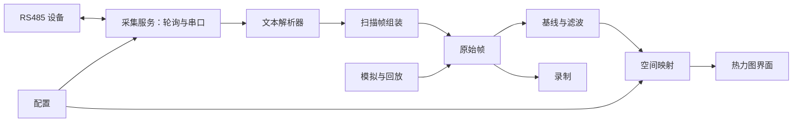

# SkinDraw 电子皮肤热力图软件设计方案

日期：2026-09-09。阶段：方案设计，尚未实现程序。

本方案依据用户提供的《数据发送格式说明.md》和《数据帧协议格式.md》。当前项目目录为空；第二份文档提到的旧仓库、分支、源码和数据集配置未在当前目录中发现，其实现描述仅作为协议兼容参考。

## 1. 推荐方案

采用 **Python + PySide6（Qt Widgets）+ PyQtGraph + NumPy + pySerial**，开发本地 Windows 桌面软件。

目标是：连接 RS485 转 USB 串口，按皮肤块轮询采集，将 ADC 数据映射成二维热力图，并支持基线校正、录制与回放。

“轻量”优先体现在架构简单、依赖数量少、单进程运行和维护方便。Qt 与 Python 运行时仍有打包体积，不能承诺几 MB 的安装包；若未来明确要求极小分发体积，再评估 C++/Qt。

| 技术 | 用途 | 选择理由 |
|---|---|---|
| Python | 应用与算法 | 方便科研阶段调试、标定和后续算法扩展 |
| PySide6 / Qt Widgets | 桌面界面、事件和线程协作 | 适合串口控制面板与本地工具 |
| PyQtGraph | 热力图、色条、单点曲线 | ImageItem 可直接显示二维数组并更新数据 |
| NumPy | 数组和数值运算 | 处理基线、滤波、翻转和旋转 |
| pySerial | 串口枚举、收发和超时 | 将硬件通信封装在独立模块 |
| JSON、logging、queue 等标准库 | 配置、日志、线程通信 | 首版控制额外依赖 |

PyQtGraph 的 ImageItem 支持行优先数组和固定色阶，适合这里的矩阵显示。[官方文档](https://pyqtgraph.readthedocs.io/en/pyqtgraph-0.13.6/api_reference/graphicsItems/imageitem.html)

首版采用单窗口、单进程，不引入前后端服务、数据库或插件框架。开发环境验证后锁定依赖版本；Windows 分发先采用目录形式，便于排查运行库问题，可使用 Qt 官方的 pyside6-deploy 打包。[Qt 部署文档](https://doc.qt.io/qtforpython-6/deployment/deployment-pyside6-deploy.html)

## 2. 协议理解与处理原则

### 2.1 已知硬件协议

- 链路：电子皮肤 → RS485 → USB 转换器 → Windows COM 端口。
- 串口：115200、8 数据位、1 停止位、无校验、无流控。
- 主机触发：`hello num <ID>\r\n`，ID 范围 1–16。
- 块头：`BLOCK_<ID>,<rows>,<cols>:\r\n`。
- 数据：后续 rows 行，每行 cols 个逗号分隔整数，范围 0–4095。
- 块尾：第一份文档要求 `END\r\n`，第二份允许省略。
- 数组：行优先；行对应供电线优先级，列对应 ADC 通道优先级。

例如，一次请求 BLOCK 1，返回一个 5×4 的数据块。它是一个局部皮肤块，不一定代表整张皮肤的一帧。

### 2.2 需要明确区分的概念

| 概念 | 软件中的含义 |
|---|---|
| 数据块 Block | 一个设备 ID 对应的一次 rows×cols 采集结果 |
| 扫描帧 Frame | 主机在一轮轮询中采集的全部配置皮肤块 |
| 显示画面 | 界面当前显示的热力图，可包含缺失或过期提示 |

`END` 首先表示当前 BLOCK 结束，不能直接作为多块皮肤的整帧结束。第二份文档的“4 块、总形状 24×3”属于旧应用示例，不作为新软件固定规格。

主模式采用**主机逐块轮询**，因为第一份文档明确描述设备收到指令才扫描。另留被动接收模式，兼容已由其他控制器组织的连续数据流；该模式不发送采集命令。

## 3. 功能范围

### 首版必须具备

1. 串口列表刷新、连接、断开，显示连接状态及错误。
2. 配置启用的 BLOCK ID、轮询顺序与每块预期形状。
3. 启动/停止采集，显示完整扫描帧率和各块更新时间。
4. 单块热力图，以及按配置位置放置的多块整体视图。
5. 固定色阶，默认 ADC 0–4095；色条显示当前数据含义。
6. 鼠标悬停显示 BLOCK ID、原始行列位置和 ADC 值。
7. 无设备模拟模式，方便验证界面和后续维护。
8. 超时、缺块、非法数据和断线提示。

### 第二阶段增加

- 无载荷基线采集，显示有符号变化量或按响应方向计算的增量。
- 可选时间平滑、单点历史曲线、坏点屏蔽。
- 原始数据录制、会话回放、热力图 PNG 导出。
- 布局预览与配置编辑。

### 后续按实际需求扩展

- 有标定实验支持后的压力换算。
- 非规则传感点坐标、皮肤轮廓遮罩和轮廓内插值。
- 新二进制协议解析器、算法模块。

这里的“热力图”表示 ADC 或其变化量的颜色分布，不直接表示温度或压力。未标定时单位必须标为 ADC 或 ΔADC。

## 4. 模块架构



模块划分以职责为边界；初期每项以一两个文件实现，不提前建立复杂的抽象层。

| 模块 | 责任 | 边界 |
|---|---|---|
| models | Block、Frame、状态与错误数据类型 | 不依赖 Qt 或串口 |
| transport | 串口打开、关闭、字节收发 | 不解释 BLOCK 或颜色 |
| protocol | 字节缓冲、文本解析、完整性校验 | 不操作 UI，不决定轮询顺序 |
| acquisition | 请求调度、响应匹配、扫描帧组装 | 不做图像绘制 |
| processing | 基线、增量、滤波、坏点掩码 | 保留原始 ADC，不原地改写原始帧 |
| mapping | 块布局、行列重排、旋转与翻转 | 不修改采集协议 |
| storage | 会话录制与回放 | 独立于 UI 刷新频率 |
| ui | 控件、热力图、状态栏 | 从数据模型读取，通过采集服务发出操作 |
| config | 配置加载、校验和保存 | 为其他模块提供明确参数 |

建议目录：

```text
skin_draw/
├─ 软件设计方案.md
├─ README.md
├─ pyproject.toml
├─ configs/
│  ├─ default.json
│  └─ layout.example.json
├─ src/
│  └─ skin_draw/
│     ├─ __init__.py
│     ├─ __main__.py
│     ├─ models.py
│     ├─ config.py
│     ├─ transport.py
│     ├─ protocol.py
│     ├─ acquisition.py
│     ├─ processing.py
│     ├─ mapping.py
│     ├─ storage.py
│     ├─ simulator.py
│     └─ ui/
│        ├─ main_window.py
│        ├─ heatmap_view.py
│        └─ control_panel.py
├─ tests/
│  ├─ test_protocol.py
│  ├─ test_acquisition.py
│  └─ test_mapping.py
└─ recordings/
```

数据模型建议：

```text
Block
  block_id, rows, cols
  values: uint16[rows, cols]
  received_at: 主机单调时钟时间
  quality_flags

Frame
  scan_id: 主机生成的扫描编号
  scan_started_at, scan_finished_at
  blocks: dict[block_id, Block]
  expected_ids, missing_ids, complete
  finish_reason: complete / timeout / stop / disconnect / repeated_id
```

主机时间代表接收或扫描时间，不能冒充设备内部 ADC 采样时间。各块采集并非同时发生，保留块级时间方便后续分析时间差。

## 5. 串口、解析与组帧

### 5.1 主动轮询

```text
开始一轮扫描
  → 请求启用列表中的第一个 ID
  → 收到匹配的完整块，或等待超时
  → 请求下一个 ID
  → 所有 ID 均已尝试
  → 发布本轮 Frame，标明缺失块
  → 进入下一轮
```

同一 RS485 总线上只允许一个未完成请求。首版不在同一轮立即重试超时 ID，将其标为缺失后进入后续调度，下一轮再采集。

接收完合法的 rows 行数据即获得完整块；可选的 `END` 被消费为块尾。即使没有 `END`，最后一个块也能正常完成，不依赖下一条头部才能交付。

发送下一请求前，需要等设备回到接收状态：配置块尾等待及总线空闲间隔，并以真实设备验证。文档中的 150 μs 是设备侧方向切换描述，不能当作 Windows 主机可以精确控制的等待时间。优先使用自动方向切换的 USB-RS485 转换器；是否需要 RTS 控制由转换器确定。

超时后，迟到回复可能污染下一轮；恢复时先消费迟到数据，等待总线安静，再恢复调度。未请求 ID 的数据作为异常记录，不并入当前扫描。由于原协议没有请求序号，特别迟的同 ID 回复仍无法绝对区分，可靠解决需固件增加请求/扫描序号。

### 5.2 解析器

采用字节缓冲加状态机：等待头部 → 接收指定数据行 → 完成块；遇到错误后丢弃当前坏块，扫描下一个合法头部恢复同步。

- 串口每次 read 可能返回半行、多行或跨块字节；保留未结束的字节段，只解析完整行。pySerial 带超时读取可能返回不足请求长度的数据。[官方 API](https://pyserial.readthedocs.io/en/stable/pyserial_api.html)
- 精确检查 ID、rows、cols、每行元素数和 ADC 范围。首版维度保护上限按 1–16 配置，实际硬件更大时显式调整。
- 不过滤中间空字段，不跳过坏行后继续拼接同一块，避免数据位置错位。
- 不把越界数值钳成 0 或 4095；该块无效并计数。
- 数据未收齐便遇到 END 或新头部：丢弃不完整块并记录原因。
- 重复 END 可以忽略；多余数据行计为协议异常，不生成额外块。
- 限制行长、缓存大小和块组装时间，避免损坏头部导致无界缓存。
- 区分串口读取超时、块接收超时和整轮扫描截止时间；读取超时不是帧结束。
- 数值范围正确也不代表传输绝对正确：当前文本协议没有校验和，无法识别所有内容损坏。

完整合法块始终可以显示。缺块帧可以发布但必须带质量标记；不能把不完整数据块伪装成合法矩阵。

### 5.3 被动模式

优先根据配置的 expected_ids 集合判断是否收齐；ID 重复和空闲超时仅作兼容性兜底。重复 ID 不一定代表新一轮，也可能是重传，因此这种模式的扫描边界是推断结果。

保持两类时钟：字节到达时间用于接收空闲判断，扫描开始时间用于限制整轮总时长。不能只使用“距离上个块完成 0.3 秒”，否则后一个大块仍在采集时可能提前结束一帧。

## 6. 热力图显示与空间映射

### 6.1 首版显示规则

- 每块使用一个 ImageItem；显式采用行优先数组，并统一原点、X/Y 轴方向。
- 默认显示真实格点，不插值；提供可选平滑显示，明确其仅影响视觉。
- 默认固定色阶 0–4095。自动色阶作为可选项，避免每帧自动缩放造成颜色不可比较。
- 各块默认共用一条色阶；切换 ΔADC 时同步切换色条范围和标签。
- 多块拼图按物理布局配置显示，每块允许不同形状。
- 缺失/过期块用灰色或明显遮罩；保留旧值时必须显示“过期”和数据年龄。
- 块之间的空白区域不填充 0，不跨越空白区域插值。

### 6.2 必须可配置的映射

协议中的行列已经是固件优先级排列后的结果，不能再次盲目按优先级排序。真实物理位置需用接线图或逐点按压实验确认。

每块保存：`id、rows、cols、x、y、pitch_x、pitch_y、row_map、col_map、rotation、flip_x、flip_y`。

统一变换顺序：原始矩阵 → 行列映射 → 旋转 → 翻转 → 按间距放置。行列映射保存索引排列，并检查长度及重复项；rotation 首版限定 0/90/180/270 度。

悬停或选择点时，要通过逆映射返回原始 BLOCK 行列，确保界面读数与录制数据对应。默认示例布局仅用于演示，不代表真实皮肤的安装位置。

### 6.3 基线和滤波

基线由用户在无载荷状态下触发，按块累积指定数量的有效样本取均值；采集中提示保持无载荷，并展示完成进度。

```text
signed_delta = float32(raw_adc) - baseline
response = direction × signed_delta
filtered = alpha × response + (1 - alpha) × previous
```

direction 为 +1 或 -1，依据受力后 ADC 上升/下降确定。uint16 必须先转为有符号或浮点类型再相减，避免负值下溢。默认保留有符号变化；非负显示作为可选显示变换。

滤波可关闭，参数与实际采样频率一起记录。坏点以掩码表示；不把它们按零值计入统计。不覆盖原始 ADC 记录；块形状变化时使对应基线失效。

## 7. 界面草图

```text
┌──────────────────────────────────────────────────────────────┐
│ SkinDraw   COM端口 [连接]  [开始/停止]  [录制] [打开回放]       │
├────────────────┬──────────────────────────────────┬──────────┤
│ 数据源          │                                  │ 色条     │
│ 串口/模拟/回放  │       整体皮肤热力图             │          │
│ 启用皮肤块      │       或选中块放大图             │ 最大值   │
│ 布局配置        │                                  │ 最小值   │
│ 原始/增量       │                                  │ 平均值   │
│ 基线采集        │                                  │ 选点值   │
│ 色阶与滤波      │                                  │          │
├────────────────┴──────────────────────────────────┴──────────┤
│ 连接状态 | 完整扫描 fps | 缺失块 | 数据年龄 | 录制状态          │
└──────────────────────────────────────────────────────────────┘
```

用户常用流程：选择串口 → 加载块和布局配置 → 连接 → 开始采集 → 必要时采集基线 → 观察或录制。

停止采集后保留最后画面并明确标记已停止；断线后标记数据过期。连接、启动、停止按钮有明确状态，防止重复打开串口或启动多个采集循环。

## 8. 并发与性能

主线程只负责 Qt 界面。一个后台采集工作线程独占串口，执行轮询、读取、解析和组帧；UI 通过线程安全命令队列控制它。后续启用录制时增加一个写盘线程。

数据发布后视为只读；跨线程使用数组时明确所有权，必要时复制，避免生产者改写 UI 正在读取的内存。

显示使用容量为 1 的“最新帧”槽位，主线程定时取用，新帧覆盖尚未绘制的旧帧。界面检查上限可设 30 Hz，仅在有变化时重绘；这不等于硬件能采集 30 fps。

录制使用独立有界队列，不受显示合并影响。写盘跟不上时明确报错并停止录制或按配置暂停主动采集，不静默丢弃记录。持续运行时限制曲线历史长度并轮转日志。

### 按文档估算硬件采集速度

以下是按文档延时和四位 ADC 文本估算的理想上限，未计入固件额外开销、USB 延迟及超时，需实测确认。

```text
115200、8N1：理论有效字节率 = 115200 / 10 = 11520 字节/秒
每块采样时间 ≈ rows × (1 + cols) ms
四位整数时，每行字节数 = 4×cols + (cols-1) + 2 = 5×cols + 1
每块总时间 ≈ 采样时间 + 请求/响应传输时间 + 方向切换与调度开销
整轮时间 ≈ 各块总时间之和
```

| 示例 | 采样时间 | 请求与响应线速时间，约 | 理想刷新上限，约 |
|---|---:|---:|---:|
| 单块 5×4 | 25 ms | 12 ms | 27 fps |
| 单块 16×16 | 272 ms | 115 ms | 2.6 fps |
| 四块 16×16 | 1088 ms | 460 ms | 0.65 fps |

可见，大阵列的主要限制可能来自采样等待与文本传输。0.3 秒不能作为所有块的统一响应超时；初始总响应超时可按估算值乘安全系数后加 USB/调度余量，实测后调整。缺失块的超时也会拉长整轮采集。

## 9. 配置、录制与回放

配置拆成通信与布局两部分，便于换硬件或换安装位置。示例块数量采用单块演示，实际启用 ID、形状和布局必须由硬件配置确定。

- 通信配置：数据源、串口、波特率、启用 ID、轮询顺序、各块形状、超时与总线空闲间隔。
- 布局配置：每块的位置、间距、映射、旋转、翻转、坏点。
- 显示配置：原始/增量模式、固定/自动色阶、滤波参数、刷新上限。

通信参数和块形状在停止采集后修改；颜色等纯显示参数可以即时生效。配置加载时检查 ID 唯一性、维度、映射合法性和布局异常。

首版录制格式建议为带版本号的 JSONL，每行一帧，保留扫描编号、主机时间、块 ID、形状、原始矩阵和缺失信息；同一会话保存配置及基线快照。只使用标准库即可读写，异形块和不完整帧也能明确表达。

```text
recordings/<会话时间>/
  metadata.json       格式版本、软件版本、配置、时钟说明
  baseline.json       基线与响应方向（如启用）
  frames.jsonl        原始帧及质量信息
```

回放按照原始时间间隔读取，可暂停、倍速和逐帧查看，复用数据处理与热力图路径。意外中断后允许恢复已写完整的行，并报告尾部截断。长期高数据量采集后再考虑分段二进制存储。

如果需要兼容旧系统的无表头 frames.csv，后续单独增加导出适配器；必须附带块顺序、形状、帧索引和缺块处理规则，避免仅靠 CSV 行数推断数据含义。

## 10. 实施顺序与验收

| 步骤 | 交付 | 验收重点 |
|---|---|---|
| 1. 协议与模拟 | 模型、解析器、模拟字节源 | 两份文档示例可解析，有/无 END 均可用 |
| 2. 单块闭环 | 串口连接、主动请求、单块图 | 实物按压位置与显示格点一致；停止响应及时 |
| 3. 多块扫描 | 调度、组帧、布局 | 异形块正确；缺块明确；旧值不伪装为新一帧 |
| 4. 实验功能 | 基线、滤波、录制、回放 | 原始值不变；回放矩阵与录制一致 |
| 5. 交付 | 依赖锁定、打包、使用说明 | 在目标 Windows 机器上启动、连接和持续运行 |

必须覆盖的自动测试集中在易出错的数据逻辑：

- 任意字节切分、粘包、半行、无 END、重复 END、错误头部恢复。
- 行列不匹配、空字段、非法整数、越界值、超长输入。
- 超时、缺块、乱序、迟到回复、最后一个块没有后续数据。
- 不同形状块组合、重复 ID、单块大于 0.3 秒的采集场景。
- 用非对称矩阵验证重排、90 度旋转、翻转及悬停逆映射。
- 录制与回放数据一致，基线相减不发生无符号下溢。

实物联调需记录实际扫描 fps、超时次数与块间时间差；连续运行至少 30 分钟检查内存是否持续增长、断线恢复和录制状态。该项是后续验收目标，目前尚未运行。

## 11. 实施前待确认的信息

以下信息不影响先开发解析器和模拟界面，但决定硬件联调与真实空间布局：

1. 实际有几块皮肤，各自 ID、行数和列数。
2. 多块皮肤的安装位置、方向、传感点间距或接线图。
3. 固件是否逐 ID 应答，以及实机是否发送 END。
4. 转换器是否自动切换 RS485 收发方向。
5. 受力后 ADC 增大还是减小；是否有物理单位标定数据。

建议首先完成“模拟输入 → 单块热力图 → 真实串口 → 多块布局”的最小闭环，然后加入实验数据录制和处理功能。
